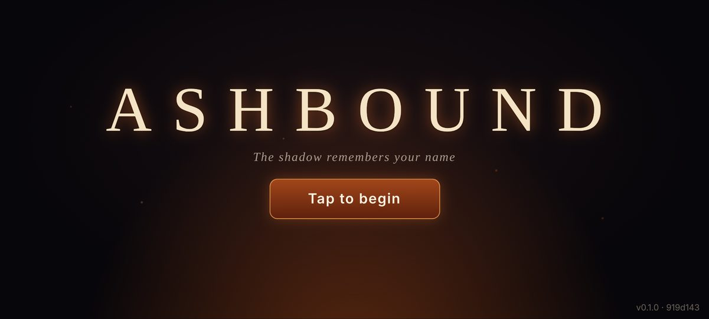
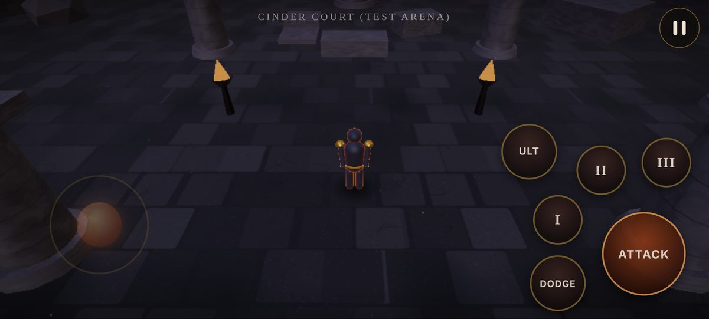
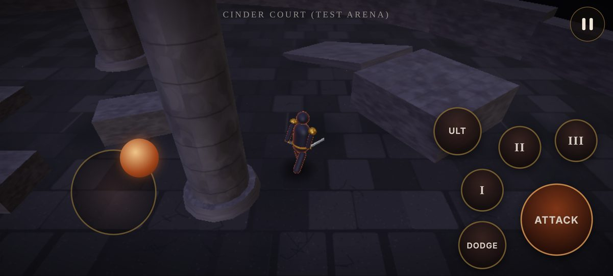
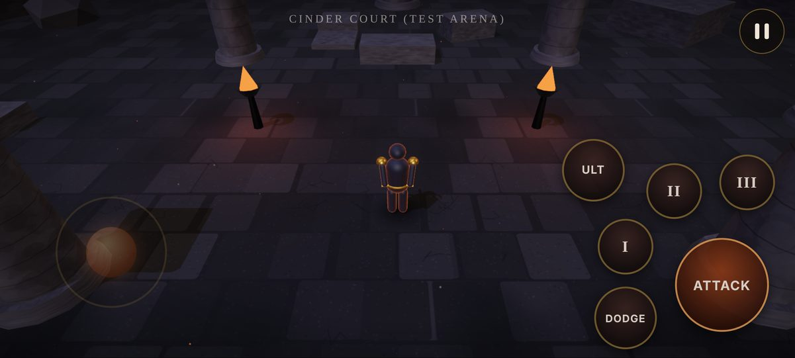
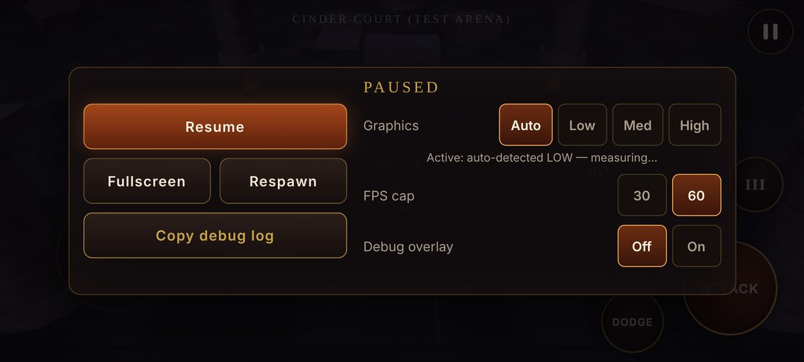
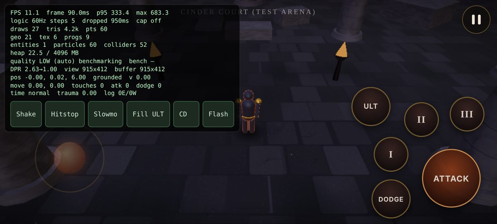

# M1 Test Report — Foundation

Build: v0.1.0 · Date: 2026-10-18 · Environment: cloud container (Node 22.22, headless Chromium 141
via Playwright 1.56.1, SwiftShader software WebGL 2).

## Summary

| #   | Check                                               | Result                                                                                                       |
| --- | --------------------------------------------------- | ------------------------------------------------------------------------------------------------------------ |
| 1   | `tsc --noEmit` (app + config/e2e projects)          | **PASS** — 0 errors                                                                                          |
| 2   | ESLint (`--max-warnings=0`) + Prettier check        | **PASS** — 0 errors, 0 warnings                                                                              |
| 3   | Vitest unit tests                                   | **PASS** — 85/85 in 9 files                                                                                  |
| 4   | `vite build`                                        | **PASS** — sizes below                                                                                       |
| 5   | Playwright smoke (Pixel 7 landscape, touch)         | **PASS** — 7/7                                                                                               |
| 6   | Manual diff review (leaks, pools, touch edge cases) | Done — findings below                                                                                        |
| 7   | GitHub Actions on push                              | **CI checks PASS**; deploy step **BLOCKED** until Pages is enabled in repo settings (see README → Deploying) |

## 3. Unit tests (Vitest)

| File               | Covers                                                                                                                                                                                                                                                                                  |
| ------------------ | --------------------------------------------------------------------------------------------------------------------------------------------------------------------------------------------------------------------------------------------------------------------------------------- |
| `core.test.ts`     | EventBus (removal during emit, once, late add), ServiceRegistry, FixedTimestep (frame-rate independence at 30/60/90/120/144 Hz, sub-step cap, clamping), TimeControl (hit-stop, no stacking, slow-mo, priority), FrameLimiter (30/60 caps on 60/90/120 Hz with vsync jitter), GameClock |
| `input.test.ts`    | Joystick shaping (dead zone, no edge jump, clamp, response curve), base-follow, InputBuffer (150 ms window, boundary, expiry, replace, independence), InputState (per-source holds, press edges, game-clock buffering, move merging, releaseAll)                                        |
| `movement.test.ts` | Angle math (shortest arc, seam), velocity approach, CharacterMotor (top/analog speed, acceleration, stop, clamp, turn rate, facing dead zone, gravity/ground stick), camera smoothing frame-rate independence, shake bounds/decay                                                       |
| `physics.test.ts`  | **Real Rapier WASM in Node**: fall + land, run speed, wall block + slide, auto-step a 24 cm ledge, blocked by 1 m block, teleport                                                                                                                                                       |
| `save.test.ts`     | Settings sanitising, migration runner (chain, no-op, future/invalid/gap), SaveStore round-trip (memory, **IndexedDB via fake-indexeddb**, localStorage), corrupt and future-version backup, migrate-on-load                                                                             |
| `quality.test.ts`  | Initial guess, step clamp, benchmark (warm-up ignored, upgrade, downgrade without oscillation, drop to LOW, median robust to spikes, max passes), preset monotonicity and budgets                                                                                                       |
| `combat.test.ts`   | Cooldowns (reuse block, independence, bounds, never negative), UltimateMeter (clamp, bad input, consume)                                                                                                                                                                                |
| `debug.test.ts`    | Log ring buffer, argument formatting (incl. circular), FrameStats (mean/max/p95/rolling), debug report contents                                                                                                                                                                         |
| `data.test.ts`     | Hero data sanity, arena props inside the wall ring, spawn clear of pillars, config ranges                                                                                                                                                                                               |

Not applicable yet (land in their milestones; tests will be added then): damage formula/crits/defense
(M5), XP curve (M8), gear upgrade rates (M8), drop tables/pity (M8), AI attack tokens (M4),
economy (M8), combo timing (M2 — the input-buffer half is tested now).

## 4. Build

| File                                    | Raw      | Gzip     | Loaded                  |
| --------------------------------------- | -------- | -------- | ----------------------- |
| `index.html`                            | 0.9 KB   | 0.4 KB   | before title            |
| `index-*.css`                           | 10.3 KB  | 3.1 KB   | before title            |
| `index-*.js` (title, log capture, save) | 18.9 KB  | 7.3 KB   | before title            |
| `App-*.js` (three.js + Rapier + game)   | 4,968 KB | 1,833 KB | behind the title screen |

**Before the title screen: ~30 KB** (budget 10 MB). Total download ~5.0 MB raw / ~1.85 MB gzip.
Rapier's compat build (WASM inlined as base64) is ~4.1 MB of the engine chunk — see DECISIONS.md.
Source maps (`*.map`) are deployed for decoding stack traces but never loaded by the browser.

## 5. Playwright smoke tests

Device: Pixel 7 profile forced to landscape 915×412, `isMobile`, `hasTouch`, DPR 2.625. Touches are
real Chrome touch events sent via CDP (`Input.dispatchTouchEvent`), producing genuine
pointer events — including two simultaneous fingers.

| Test                                                                                                                                                                                                                                                                        | Result |
| --------------------------------------------------------------------------------------------------------------------------------------------------------------------------------------------------------------------------------------------------------------------------- | ------ |
| Title loads, zero console errors                                                                                                                                                                                                                                            | PASS   |
| Arena + HUD render after tap (draw calls 5–150, triangles > 1k, non-blank screenshot by pixel variance, hero grounded)                                                                                                                                                      | PASS   |
| Joystick drag moves hero forward-right; 3 ATTACK taps with a second finger while steering → 3 presses, ≥3 swings; after release: no active touches, speed → 0                                                                                                               | PASS   |
| Finger sliding off a skill button releases it before lift; cooldown ring starts                                                                                                                                                                                             | PASS   |
| Pause menu: Copy debug log → clipboard contains report with GPU info and stats; FPS cap 30 + quality HIGH applied; resume                                                                                                                                                   | PASS   |
| Hidden gesture: triple-tap top-left toggles the debug overlay on and off                                                                                                                                                                                                    | PASS   |
| **60 s scripted soak**: circling joystick, ATTACK every ~0.3 s, skills, stick finger lifted/re-placed — zero errors, every ATTACK tap registered exactly once, no input left held; heap after forced GC **9.85 → 10.25 MB**, trend 7.7 KB/s (limit 20 KB/s, net limit 3 MB) | PASS   |

Extended diagnostic soak (4 minutes, same script): heap plateaus at ~10.5 MB — see "Memory".

Headless numbers are **not** performance numbers: SwiftShader renders on the CPU (~11–14 FPS
there). In headless the auto benchmark picks LOW for that reason. Real performance must come
from your phone's debug overlay.

### Screenshots (taken by the tests, downscaled)

|                                                                |                                                                               |
| -------------------------------------------------------------- | ----------------------------------------------------------------------------- |
| Title                        | In game (LOW, auto)                       |
| Moving + attacking  | HIGH (bloom, shadows, brazier lights)  |
| Pause menu                   | Debug overlay                       |

## 6. Manual review — found and fixed during M1

| Finding                                                                                                     | Fix                                                                |
| ----------------------------------------------------------------------------------------------------------- | ------------------------------------------------------------------ |
| Probing WebGL on the game canvas would lock its context attributes (antialias choice silently ignored)      | GPU probe uses a throwaway canvas, then releases it                |
| `PCFSoftShadowMap` removed in three r186                                                                    | Use `PCFShadowMap`                                                 |
| `alphaMap` reads the green channel; blob-shadow texture was alpha-only                                      | Luminance variant of the radial texture                            |
| Ramp didn't meet its platform (rotation math)                                                               | Recomputed platform position from the ramp's raised end            |
| Rim light too strong (hero read as orange), flames clipped to white, camera too far                         | Tuned rim power/strength, flame HDR factor, camera distance/height |
| Debug overlay blocked joystick touches and covered a third of the screen                                    | Overlay is click-through except cheat buttons; compact layout      |
| Pause menu overflowed a 412 px tall screen                                                                  | Two-column landscape layout, no scrolling needed                   |
| Game kept simulating/rendering behind the portrait "rotate" hint                                            | Auto-pause on portrait                                             |
| e2e could run against a stale `dist/`                                                                       | Playwright web server always rebuilds first                        |
| Tests: canvas readback after compositing returned a cleared buffer; skill state read before next logic tick | Pixel variance from a real screenshot; poll for state              |

Review checklist:

- **Listeners**: every DOM listener is registered through `listen()`/`onTap()` and removed in
  `dispose()`; window listeners in App are removed in `dispose()`.
- **GPU resources**: ArenaBuilder, PlaceholderHeroVisual, EmberField, BlobShadow, Atmosphere and
  RenderContext track and dispose every geometry/material/texture/render target they create.
  `renderer.info.memory` in the overlay stays constant during play (geo 21, tex 6).
- **Per-frame allocations**: none in our hot paths (loop, logic step, render, camera, particles,
  shadow follow) — scratch vectors are preallocated. Remaining small churn: three.js internals,
  Rapier's wasm-bindgen wrappers (library), and HUD cooldown text while a cooldown runs.
- **Pools**: no pooled entities in M1 (enemies, projectiles, damage numbers arrive in M2/M4).
- **Touch edge cases**: multi-finger, slide-off, lift during pause, blur/visibility change,
  resize/rotation, `touchend` with zero touches → all release input (tested where automatable).

## Memory

- 60 s soak (final run): heap after GC 9.85 → 10.25 MB (+0.40 MB), 7.7 KB/s trend.
- 4-minute diagnostic soak (same script, sample every 20 s after forced GC):
  `9.72 10.24 10.33 10.31 10.50 10.49 10.49 10.57 10.52 10.56 10.52 10.53` MB — slope over the whole
  run 2.5 KB/s, **second half 0.11 KB/s**, 0 errors, 2,697 frames.
- Conclusion: the early rise is warm-up (JIT, caches) and **plateaus at ~10.5 MB; no leak trend.**

## 7. Could not be tested here

- **Real-device performance and feel** (FPS, thermal throttling, touch latency, haptics): needs
  your phone + debug overlay.
- **Fullscreen + landscape lock**: headless Chromium rejects both (logged as warnings, by design);
  must be checked on Android Chrome.
- **Gamepad**: no gamepad in the container. Logic is shared with tested input code; mapping
  untested — UNTESTED.
- **Audio unlock**: AudioContext creation is exercised, audible output is not verifiable headless
  — UNTESTED.
- **Deployed URL**: blocked until GitHub Pages is enabled (see README).
